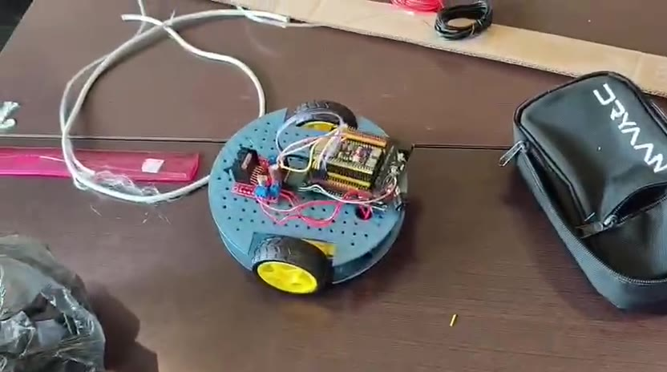
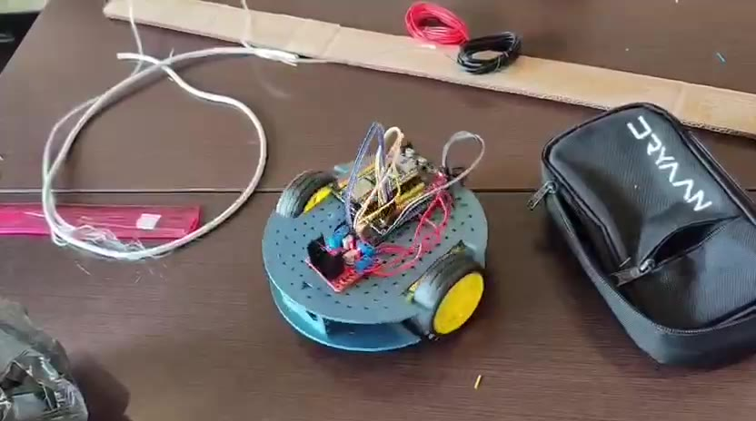
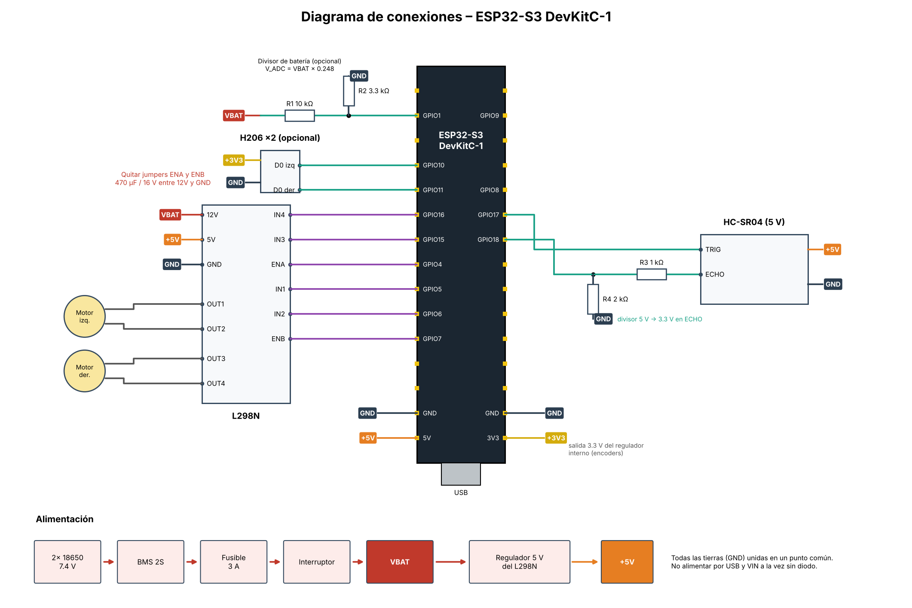
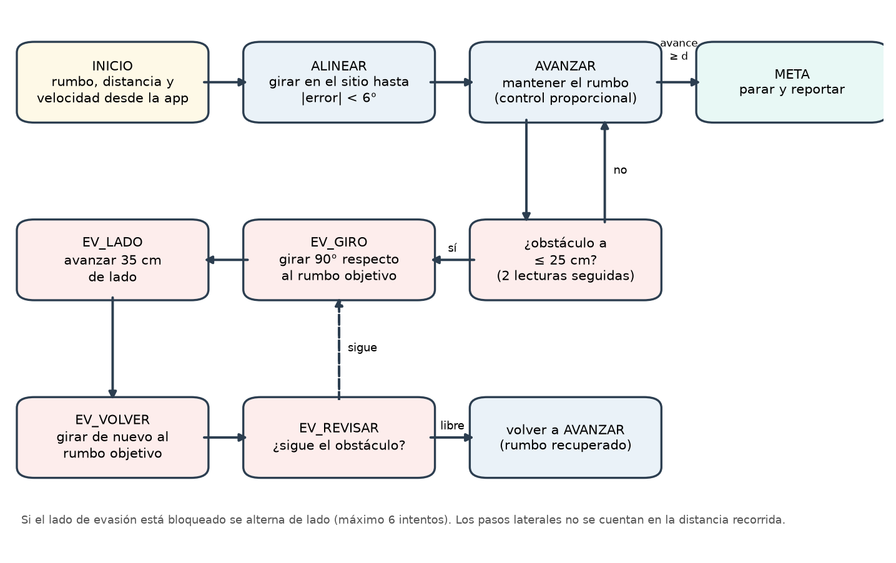

# Robot móvil diferencial con ESP32 / ESP32-S3

**Universidad Militar Nueva Granada – Ingeniería Mecatrónica · Campus Cajicá**<br>
**Asignatura:** Micros y Laboratorio · **Grupo 5**<br>
**Integrantes:**

- Maria Fernanda Peñuela Romero
- Juan David Artunduaga Diaz
- Alix Estefanía Maldonado Roa

Este repositorio reúne el **avance del carro robótico**. El objetivo del robot es:

1. **Moverse hacia adelante, atrás, a la izquierda y a la derecha.**
2. **Detectar objetos al frente y esquivarlos.**

El robot es un carro de **tracción diferencial** (2 motores TT + rueda loca) con chasis propio de acrílico cortado en láser y piezas impresas en 3D. Lo controla un **ESP32-S3 DevKitC-1** (el firmware también compila para el ESP32 DevKit V1). El ESP32 crea su propia red WiFi y sirve una página web con los botones ▲ ▼ ◀ ▶ (o teclas W A S D). Un sensor ultrasónico **HC-SR04** detecta los obstáculos al frente y el robot los rodea para seguir su camino.

| Módulo | Qué hace | Tecnología |
|---|---|---|
| **Chasis** | 2 placas Ø180 mm + soportes de motor, ultrasónico y mástil del sensor | Acrílico 3 mm (láser) + PETG/PLA (3D), modelo paramétrico en CadQuery |
| **Tracción** | Adelante, atrás y giro a izquierda/derecha en el sitio | 2 motores TT 1:48 + L298N, PWM 1 kHz |
| **Detección de obstáculos** | Mide la distancia al objeto que está al frente | HC-SR04 con divisor 5 V → 3,3 V en ECHO |
| **Odometría** | Distancia recorrida | 2 × H206 + disco de 20 ranuras (opcional; sin ellos mide por tiempo) |
| **Aplicación** | Control manual, modo autónomo con evasión, registro CSV | Página web servida por el ESP32 (`http://192.168.4.1`) |
| **Evasión de obstáculos** | Rodea el obstáculo y retoma la dirección original | Máquina de estados en el firmware |


*Fragmento del video de prueba del robot armado. Video completo (18 s): [`docs/fotos/robot_prueba.mp4`](docs/fotos/robot_prueba.mp4).*

---

## Contenido

1. [Arquitectura del sistema](#1-arquitectura-del-sistema)
2. [Diseño mecánico (CAD)](#2-diseño-mecánico-cad)
3. [Diseño eléctrico](#3-diseño-eléctrico)
4. [Firmware](#4-firmware)
5. [Paso a paso de lo realizado](#5-paso-a-paso-de-lo-realizado)
6. [Resultados](#6-resultados)
7. [Cómo compilar y cargar](#7-cómo-compilar-y-cargar)
8. [Estructura del repositorio](#8-estructura-del-repositorio)
9. [Problemas comunes](#9-problemas-comunes)

---

## 1. Arquitectura del sistema

| Robot armado | Otra vista | Página de control (`192.168.4.1`) |
|---|---|---|
|  |  |  |

*Fotogramas tomados del video de prueba.*


- **Potencia:** 2 baterías 18650 (7,4 V) → BMS 2S → fusible 3 A → interruptor → L298N. El regulador de 5 V del L298N alimenta el ESP32.
- **Control:** el ESP32 lee el HC-SR04 y genera el PWM y la dirección de los motores.
- **Aplicación:** el ESP32 funciona como punto de acceso WiFi (`ROBOT_MOVIL`). La página consulta el estado cada 100 ms por HTTP (rutas `/estado`, `/ctrl`, `/mision`, `/stop`, etc.).

---

## 2. Diseño mecánico (CAD)

Chasis híbrido: **2 placas de acrílico de 3 mm** (corte láser) unidas con separadores de latón M3 × 40 mm, y **piezas impresas en 3D**. Diámetro 180 mm, altura total ~150 mm.


**Medidas clave** (de `cad/LEEME.md`):

| Parámetro | Valor |
|---|---|
| Diámetro de rueda | 65 mm (altura del eje 32,5 mm) |
| Distancia entre ruedas (`L` de la cinemática diferencial) | 150 mm |
| Despeje al suelo de la placa inferior | 15,25 mm |

El eje de las ruedas pasa por el centro del robot, así que gira sobre sí mismo sin desplazarse.

**Piezas a fabricar**

| Pieza | Cant. | Proceso | Archivo |
|---|---|---|---|
| Placa inferior | 1 | Láser, acrílico 3 mm | `cad/DXF/placa_inferior.dxf` |
| Placa superior (rejilla M3 cada 10 mm) | 1 | Láser, acrílico 3 mm | `cad/DXF/placa_superior.dxf` |
| Soporte motor izq. / der. | 1 + 1 | Impresión 3D | `cad/STL/soporte_motor_*.stl` |
| Soporte ultrasónico (HC-SR04) | 1 | Impresión 3D | `cad/STL/soporte_ultrasonico.stl` |
| Mástil del sensor (80 mm) | 1 | Impresión 3D | `cad/STL/mastil_magnetometro.stl` |
| Patín trasero | 1 | Impresión 3D | `cad/STL/patin_trasero.stl` |
| Separador de rueda loca (si hace falta) | 1 | Impresión 3D | `cad/STL/separador_rueda_loca.stl` |

Impresión sugerida: PETG o PLA, capa 0,2 mm, 3 perímetros, 30 % de relleno.

Todo el chasis sale de un modelo paramétrico, `cad/robot_chasis.py` (CadQuery). Si cambian las medidas de una pieza comprada, se ajusta la sección `PARAMETROS` y se regeneran STEP, DXF y STL:

```bash
pip install cadquery
python cad/robot_chasis.py
```

Los `.step` se abren en SolidWorks (*Archivo → Abrir → STEP*). Ver `cad/LEEME.md`.

---

## 3. Diseño eléctrico

### 3.1 Diagrama de conexiones (ESP32-S3 DevKitC-1)



### 3.2 Asignación de pines

El firmware elige los pines según la placa (`#if CONFIG_IDF_TARGET_ESP32S3`):

| Función | ESP32-S3 | ESP32 DevKit V1 |
|---|---|---|
| L298N ENA / IN1 / IN2 (motor izq.) | 4 / 5 / 6 | 25 / 26 / 27 |
| L298N ENB / IN3 / IN4 (motor der.) | 7 / 15 / 16 | 14 / 33 / 32 |
| HC-SR04 TRIG / ECHO | 17 / 18 | 19 / 18 |
| Encoders H206 izq. / der. | 10 / 11 | 34 / 35 |
| Divisor de batería (ADC) | 1 | 36 |

En el ESP32-S3 se evitaron los pines 0, 3, 45 y 46 (arranque), 19 y 20 (USB), 26 a 37 (flash/PSRAM) y 43 y 44 (UART0).

El diagrama para el ESP32 DevKit V1 está en [`docs/diagrama_conexiones.png`](docs/diagrama_conexiones.png).

### 3.3 Puntos críticos de alimentación

1. Medir con multímetro la salida de 5 V del L298N antes de conectarla al ESP32.
2. Todas las tierras unidas en un punto común.
3. Capacitor de 470 µF entre 12V y GND del L298N para absorber los picos de los motores.
4. ECHO del HC-SR04 con divisor 1 kΩ / 2 kΩ (5 V → 3,3 V).
5. No conectar USB y batería al mismo tiempo sin un diodo en VIN.

La lista de materiales con precios aproximados está en [`docs/BOM_y_conexiones.md`](docs/BOM_y_conexiones.md).

---

## 4. Firmware

Arduino IDE 2 con el core **esp32 3.x**. No necesita librerías externas: `WiFi`, `WebServer`, `Wire` y `Preferences` vienen en el core.

| Carpeta | Qué es |
|---|---|
| `firmware/robot_manual/` | Primera versión: solo movimiento manual por WiFi (botones o W A S D) |
| `firmware/robot_esp32/` | Segunda versión: manual + HC-SR04 con parada ante obstáculos |
| `firmware/robot_completo/` | **Versión actual**: manual, encoders, modo autónomo con evasión y registro CSV |
| `firmware/escaner_i2c/` | Utilidad: busca módulos I²C en SDA=8/SCL=9 y en el orden cruzado |
| `firmware/escaner_i2c_pines/` | Utilidad: prueba pares de pines libres del S3 y verifica el chip leyendo su registro de identidad |

### 4.1 Movimiento manual

Desde la página: ▲ adelante, ▼ atrás, ◀ izquierda y ▶ derecha (giro en el sitio), o las teclas W A S D. En modo manual el robot **no avanza si hay un objeto a menos de 15 cm** (`DIST_PARADA_CM`), aunque sí puede retroceder o girar. Si la página deja de enviar órdenes durante 600 ms, el robot se detiene.

### 4.2 Detección y evasión de obstáculos (modo autónomo)



En la página se elige la dirección de avance, la distancia y la velocidad, y se pulsa **▶ Iniciar misión**.

1. **Orientarse:** gira en el sitio hasta quedar en la dirección elegida (error < 6°).
2. **Avanzar:** va hacia adelante manteniendo esa dirección.
3. **Detectar:** si el HC-SR04 ve un objeto a **≤ 25 cm** en 2 lecturas seguidas (para evitar falsos positivos), se detiene.
4. **Esquivar:** gira 90°, avanza 35 cm de lado, vuelve a girar a la dirección original y revisa si el camino está libre. Si el lado está bloqueado, prueba por el otro lado. Máximo 6 intentos.
5. **Llegar:** se detiene cuando completa la distancia pedida. Los pasos laterales no cuentan.

El giro se controla con la diferencia de velocidad entre las dos ruedas, y la distancia se cuenta con los encoders H206 (o por tiempo si no están). Cualquier botón de movimiento o **■** cancela el modo autónomo.

### 4.3 Parámetros ajustables (sección `CONFIGURACION` del `.ino`)

| Constante | Valor actual | Para qué |
|---|---|---|
| `PWM_MIN` | 110 | PWM mínimo para que arranque el motor |
| `DIST_PARADA_CM` | 15 | Modo manual: no avanza si hay algo más cerca |
| `DIST_EVASION_CM` | 25 | Modo autónomo: empieza la evasión |
| `PASO_LATERAL_CM` | 35 | Avance lateral en cada evasión |
| `MAX_INTENTOS_EV` | 6 | Intentos de evasión antes de abortar |
| `KP_GIRO`, `GIRO_MIN`, `GIRO_MAX` | 0,7 / 28 / 55 | Giro en el sitio |
| `KP_RUMBO`, `MAX_CORR` | 0,9 / 30 | Mantener la dirección al avanzar |
| `TOL_GIRO` | 6° | Tolerancia del giro |
| `INVERTIR_IZQ`, `INVERTIR_DER`, `INTERCAMBIAR_LADOS` | false / true / true | Sentido y lado de los motores según el cableado |

---

## 5. Paso a paso de lo realizado

### Paso 1: Diseño del chasis
Se modeló el chasis en CadQuery (`cad/robot_chasis.py`) con medidas típicas del motor TT, la rueda de 65 mm y la rueda loca. Se exportaron las piezas a STEP (para SolidWorks), las placas a DXF (corte láser) y los soportes a STL (impresión 3D).

### Paso 2: Selección de componentes y conexiones
Se armó la lista de materiales (`docs/BOM_y_conexiones.md`), se asignaron los pines del ESP32 y del ESP32-S3 evitando los de arranque, flash y USB, y se generaron los diagramas de bloques y de conexiones con `docs/diagramas.py`.

### Paso 3: Movimiento manual
Con `firmware/robot_manual` se comprobó la tracción: el ESP32 crea la red `ROBOT_MOVIL` y el robot se maneja desde el navegador con botones o con W A S D.

### Paso 4: Detección de obstáculos
Con `firmware/robot_esp32` se añadió el HC-SR04 con su divisor de voltaje en ECHO, y la parada automática a 15 cm de un obstáculo.

### Paso 5: Versión completa
`firmware/robot_completo` integra todo para el ESP32-S3: odometría con encoders H206 (o por tiempo si no están), modo autónomo que avanza, detecta y esquiva obstáculos, y descarga de un registro CSV cada 0,1 s desde la página.

### Paso 6: Armado por etapas
Se conectó un módulo a la vez (motores, HC-SR04, encoders), verificando cada uno en la página antes de seguir (`docs/ENTREGA2_armado_y_pruebas.md`).

---

## 6. Resultados

**Tabla 4.** Distancia recorrida en misión recta (valores aproximados).

| Pedida (cm) | Medida (cm) | Error (cm) |
|---|---|---|
| 100 | 102 | +2 |

El robot recorrió 102 cm cuando se le pidieron 100 cm: un error de +2 cm (+2 %).

---

## 7. Cómo compilar y cargar

1. Instalar **Arduino IDE 2** y el core **esp32** de Espressif (Gestor de placas).
2. Abrir `firmware/robot_completo/robot_completo.ino` (la pestaña `pagina_web.h` se abre sola).
3. *Herramientas → Placa → esp32 → **ESP32S3 Dev Module*** (o *ESP32 Dev Module* para el DevKit V1).
   - Módulo N16R8 / N8R8: *PSRAM → OPI PSRAM*. N8 o N8R2: *Disabled / QSPI*.
   - Usar el USB-C marcado **UART/COM**. Si se usa el marcado **USB**, poner *USB CDC On Boot → Enabled*.
4. Subir. Si se queda en `Connecting....`: mantener **BOOT**, pulsar **RST** y soltar.
5. Monitor serie a **115200**: debe mostrar `WiFi: ROBOT_MOVIL`.
6. Conectarse a la red **ROBOT_MOVIL** (la clave está en `WIFI_PASS` del `.ino`) y abrir **http://192.168.4.1**.

---

## 8. Estructura del repositorio

```
.
├── README.md
├── .gitignore
├── cad/
│   ├── LEEME.md                  # cómo abrir en SolidWorks, piezas, tornillería
│   ├── robot_chasis.py           # modelo paramétrico (CadQuery)
│   ├── vista_ensamble.png
│   ├── vista_placas_dxf.png
│   ├── DXF/                      # placas para corte láser
│   ├── STEP/                     # piezas y ensamble
│   └── STL/                      # piezas para impresión 3D
├── docs/
│   ├── fotos/                    # fotogramas, GIF y video del robot, Tabla 4
│   ├── BOM_y_conexiones.md       # materiales, pines, alimentación
│   ├── ENTREGA2_armado_y_pruebas.md
│   ├── diagramas.py              # regenera los diagramas
│   ├── diagrama_bloques.png/.svg
│   ├── diagrama_conexiones.png/.svg      # ESP32 DevKit V1
│   ├── diagrama_conexiones_s3.png/.svg   # ESP32-S3 DevKitC-1
│   └── informe/                  # scripts y figuras del informe
└── firmware/
    ├── LEEME.md
    ├── robot_completo/           # versión actual
    ├── robot_esp32/              # manual + parada por obstáculo
    ├── robot_manual/             # solo manual
    ├── escaner_i2c/
    └── escaner_i2c_pines/
```

---

## 9. Problemas comunes

| Problema | Causa probable |
|---|---|
| La evasión se activa sola | ECHO sin divisor o cable suelto: la distancia salta |
| El ESP32 se reinicia al arrancar los motores | Batería baja o falta el capacitor de 470 µF |
| Un motor gira al revés | Cambiar `INVERTIR_IZQ` / `INVERTIR_DER` |
| ▶ gira a la izquierda | Motores cruzados: intercambiar OUT1-OUT2 con OUT3-OUT4 o cambiar `INTERCAMBIAR_LADOS` |
