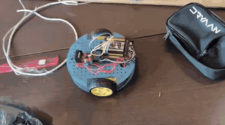
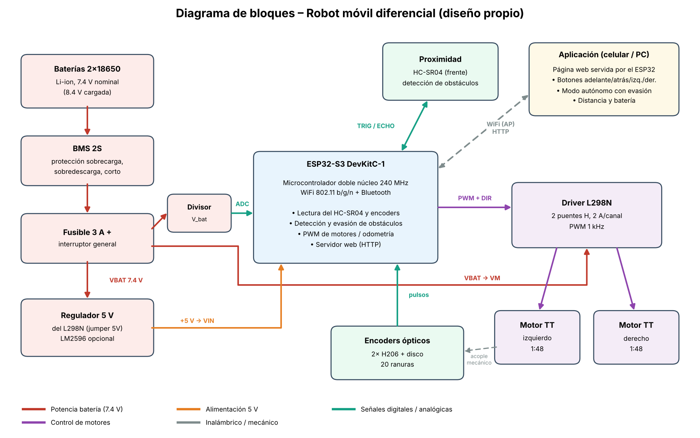
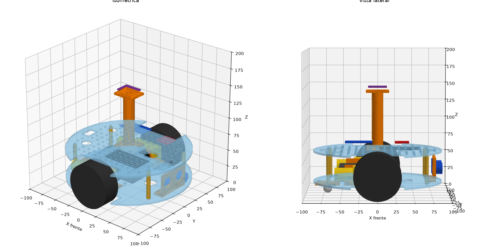
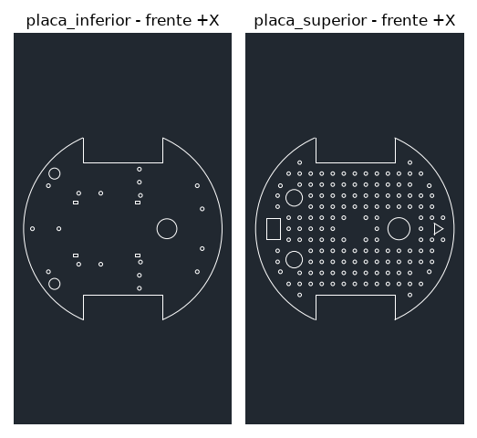

# Robot móvil diferencial con ESP32 / ESP32-S3

**Universidad Militar Nueva Granada – Ingeniería Mecatrónica · Campus Cajicá**<br>
**Asignatura:** Micros y Laboratorio · **Grupo 5**<br>
**Integrantes:**

- Maria Fernanda Peñuela Romero
- Juan David Artunduaga Diaz
- Alix Estefanía Maldonado Roa

Este repositorio reúne el **avance del carro robótico** del proyecto de manejo de monedas. El proyecto completo tiene cuatro etapas: (1) identificar monedas, (2) guardarlas en su frasco, (3) recoger por voz el frasco pedido con un carro robótico y (4) llevarlo a una meta esquivando de 3 a 5 obstáculos. Este repositorio cubre la **base del carro de las Etapas 3 y 4**.

El robot es un carro de **tracción diferencial** (2 motores TT + rueda loca) con chasis propio de acrílico cortado en láser y piezas impresas en 3D. Lo controla un **ESP32-S3 DevKitC-1** (el firmware también compila para el ESP32 DevKit V1). El ESP32 crea su propia red WiFi y sirve una página web desde la que se maneja el robot, se calibra la brújula y se lanzan misiones autónomas: **ir a un rumbo (grados desde el norte) durante una distancia, esquivando obstáculos** con el sensor ultrasónico.

| Módulo | Qué hace | Tecnología | Estado |
|---|---|---|---|
| **Chasis** | 2 placas Ø180 mm + soportes de motor, ultrasónico y mástil del magnetómetro | Acrílico 3 mm (láser) + PETG/PLA (3D), modelo paramétrico en CadQuery | Diseñado (STEP, DXF, STL) |
| **Tracción** | Movimiento diferencial, giro en el sitio | 2 motores TT 1:48 + L298N, PWM 1 kHz | Firmware listo |
| **Rumbo** | Ángulo respecto al norte | QMC5883L/HMC5883L (GY-273), fusión opcional con MPU6050 (GY-521) | Firmware listo |
| **Proximidad** | Detecta obstáculos al frente | HC-SR04 con divisor 5 V → 3,3 V en ECHO | Firmware listo |
| **Odometría** | Distancia recorrida | 2 × H206 + disco de 20 ranuras (opcional; sin ellos mide por tiempo) | Firmware listo |
| **Aplicación** | Control manual, calibración, misiones, registro CSV | Página web servida por el ESP32 (`http://192.168.4.1`) | Firmware listo |
| **Evasión de obstáculos** | Rodea el obstáculo y recupera el rumbo objetivo | Máquina de estados en el firmware | Firmware listo · Pruebas: _pendiente_ |
| **Reconocimiento de voz y recogida del frasco** | Etapa 3 | _Por definir_ | _Pendiente_ (no está en este avance) |



*Fragmento del video de prueba del robot armado. Video completo (18 s): [`docs/fotos/robot_prueba.mp4`](docs/fotos/robot_prueba.mp4).*

> ⚠️ **Resultados de pruebas:** por ahora hay una medición de distancia (sección [6](#6-pruebas)). El resto de las pruebas está pendiente.

---

## Contenido

1. [Arquitectura del sistema](#1-arquitectura-del-sistema)
2. [Diseño mecánico (CAD)](#2-diseño-mecánico-cad)
3. [Diseño eléctrico](#3-diseño-eléctrico)
4. [Firmware](#4-firmware)
5. [Paso a paso de lo realizado](#5-paso-a-paso-de-lo-realizado)
6. [Pruebas](#6-pruebas)
7. [Cómo compilar y cargar](#7-cómo-compilar-y-cargar)
8. [Estructura del repositorio](#8-estructura-del-repositorio)
9. [Problemas comunes](#9-problemas-comunes)
10. [Estado y próximos pasos](#10-estado-y-próximos-pasos)

---

## 1. Arquitectura del sistema

| Robot armado | Otra vista | Página de control (`192.168.4.1`) |
|---|---|---|
|  |  |  |

*Fotogramas tomados del video de prueba.*



- **Potencia:** 2 baterías 18650 (7,4 V) → BMS 2S → fusible 3 A → interruptor → L298N. El regulador de 5 V del L298N alimenta el ESP32.
- **Control:** el ESP32 lee sensores por I²C y GPIO, calcula el rumbo y genera el PWM de los motores.
- **Aplicación:** el ESP32 funciona como punto de acceso WiFi (`ROBOT_MOVIL`). La página consulta el estado cada 100 ms por HTTP (rutas `/estado`, `/ctrl`, `/mision`, `/calibrar`, etc.).

> Nota: el diagrama de bloques dice "WebSocket", pero el firmware actual usa la librería `WebServer` con peticiones HTTP periódicas. No usa WebSocket.

---

## 2. Diseño mecánico (CAD)

Chasis híbrido: **2 placas de acrílico de 3 mm** (corte láser) unidas con separadores de latón M3 × 40 mm, y **piezas impresas en 3D**. Diámetro 180 mm, altura total ~150 mm.





**Medidas clave** (de `cad/LEEME.md`):

| Parámetro | Valor |
|---|---|
| Diámetro de rueda | 65 mm (altura del eje 32,5 mm) |
| Distancia entre ruedas (`L` de la cinemática diferencial) | 150 mm |
| Despeje al suelo de la placa inferior | 15,25 mm |
| Altura del magnetómetro | ~150 mm del suelo, ~115 mm sobre los motores |

El eje de las ruedas pasa por el centro del robot, así que gira sobre sí mismo sin desplazarse.

**Piezas a fabricar**

| Pieza | Cant. | Proceso | Archivo |
|---|---|---|---|
| Placa inferior | 1 | Láser, acrílico 3 mm | `cad/DXF/placa_inferior.dxf` |
| Placa superior (rejilla M3 cada 10 mm) | 1 | Láser, acrílico 3 mm | `cad/DXF/placa_superior.dxf` |
| Soporte motor izq. / der. | 1 + 1 | Impresión 3D | `cad/STL/soporte_motor_*.stl` |
| Soporte ultrasónico (HC-SR04 + agujeros para VL53L0X) | 1 | Impresión 3D | `cad/STL/soporte_ultrasonico.stl` |
| Mástil del magnetómetro (80 mm) | 1 | Impresión 3D | `cad/STL/mastil_magnetometro.stl` |
| Patín trasero | 1 | Impresión 3D | `cad/STL/patin_trasero.stl` |
| Separador de rueda loca (si hace falta) | 1 | Impresión 3D | `cad/STL/separador_rueda_loca.stl` |

Impresión sugerida: PETG o PLA, capa 0,2 mm, 3 perímetros, 30 % de relleno. En el mástil y cerca del magnetómetro se usan **tornillos de nylon o latón**, porque el acero desvía la brújula.

Todo el chasis sale de un modelo paramétrico, `cad/robot_chasis.py` (CadQuery). Si cambian las medidas de una pieza comprada, se ajusta la sección `PARAMETROS` y se regeneran STEP, DXF y STL:

```bash
pip install cadquery
python cad/robot_chasis.py
```

Los `.step` se abren en SolidWorks (*Archivo → Abrir → STEP*). Ver `cad/LEEME.md`.

---

## 3. Diseño eléctrico

### 3.1 Diagrama de conexiones (ESP32-S3 DevKitC-1)


### 3.2 Asignación de pines

El firmware elige los pines según la placa (`#if CONFIG_IDF_TARGET_ESP32S3`):

| Función | ESP32-S3 | ESP32 DevKit V1 |
|---|---|---|
| L298N ENA / IN1 / IN2 (motor izq.) | 4 / 5 / 6 | 25 / 26 / 27 |
| L298N ENB / IN3 / IN4 (motor der.) | 7 / 15 / 16 | 14 / 33 / 32 |
| HC-SR04 TRIG / ECHO | 17 / 18 | 19 / 18 |
| I²C SDA / SCL (magnetómetro, MPU6050) | 8 / 9 | 21 / 22 |
| Encoders H206 izq. / der. | 10 / 11 | 34 / 35 |
| Divisor de batería (ADC) | 1 | 36 |

En el ESP32-S3 se evitaron los pines 0, 3, 45 y 46 (arranque), 19 y 20 (USB), 26 a 37 (flash/PSRAM) y 43 y 44 (UART0).

El diagrama para el ESP32 DevKit V1 está en [`docs/diagrama_conexiones.png`](docs/diagrama_conexiones.png).

### 3.3 Puntos críticos de alimentación

1. Medir con multímetro la salida de 5 V del L298N antes de conectarla al ESP32.
2. Todas las tierras unidas en un punto común.
3. Capacitor de 470 µF entre 12V y GND del L298N para absorber los picos de los motores.
4. ECHO del HC-SR04 con divisor 1 kΩ / 2 kΩ (5 V → 3,3 V).
5. No conectar USB y batería al mismo tiempo sin un diodo en VIN.

La lista de materiales con precios aproximados está en [`docs/BOM_y_conexiones.md`](docs/BOM_y_conexiones.md).

---

## 4. Firmware

Arduino IDE 2 con el core **esp32 3.x**. No necesita librerías externas: `WiFi`, `WebServer`, `Wire` y `Preferences` vienen en el core.

| Carpeta | Qué es |
|---|---|
| `firmware/robot_manual/` | Primera versión: solo modo manual por WiFi (botones o W A S D) |
| `firmware/robot_esp32/` | Entrega 1 (Guía 5): manual + magnetómetro + calibración + parada por obstáculo |
| `firmware/robot_completo/` | **Versión actual** (Guías 5 y 6): todo lo anterior + fusión con MPU6050, encoders, misiones autónomas, evasión y registro CSV |
| `firmware/escaner_i2c/` | Utilidad: busca módulos I²C en SDA=8/SCL=9 y en el orden cruzado |
| `firmware/escaner_i2c_pines/` | Utilidad: prueba pares de pines libres del S3 y verifica el chip leyendo su registro de identidad |

### 4.1 Lógica de la misión autónoma (`robot_completo`)


1. **Alinear:** gira en el sitio hasta que el error de rumbo sea menor que 6° (control proporcional, `KP_GIRO`).
2. **Avanzar:** mantiene el rumbo corrigiendo la velocidad de cada rueda (`KP_RUMBO`).
3. **Obstáculo a ≤ 25 cm** (2 lecturas seguidas, para evitar falsos positivos): gira 90° respecto al rumbo objetivo, avanza 35 cm de lado, vuelve al rumbo objetivo y revisa si sigue bloqueado. Si el lado está bloqueado, cambia de lado. Máximo 6 intentos.
4. **Meta:** se detiene cuando la distancia avanzada **sobre el rumbo objetivo** llega a la pedida. Los pasos laterales no cuentan.

Cualquier botón de movimiento o **■** cancela la misión. En modo manual, si no llegan órdenes en 600 ms, el robot se detiene.

### 4.2 Parámetros ajustables (sección `CONFIGURACION` del `.ino`)

| Constante | Valor actual | Para qué |
|---|---|---|
| `PWM_MIN` | 110 | PWM mínimo para que arranque el motor |
| `DIST_PARADA_CM` | 15 | Modo manual: no avanza si hay algo más cerca |
| `DIST_EVASION_CM` | 25 | Modo autónomo: empieza la evasión |
| `PASO_LATERAL_CM` | 35 | Avance lateral en cada evasión |
| `KP_GIRO`, `GIRO_MIN`, `GIRO_MAX` | 0,7 / 28 / 55 | Giro en el sitio |
| `KP_RUMBO`, `MAX_CORR` | 0,9 / 30 | Mantener rumbo avanzando |
| `TOL_GIRO` | 6° | Tolerancia del giro |
| `DECLINACION` | −8° | Declinación magnética aproximada de Bogotá |
| `INVERTIR_IZQ`, `INVERTIR_DER`, `INTERCAMBIAR_LADOS` | false / true / true | Sentido y lado de los motores según el cableado |

---

## 5. Paso a paso de lo realizado

### Paso 1: Diseño del chasis
Se modeló el chasis en CadQuery (`cad/robot_chasis.py`) con medidas típicas del motor TT, la rueda de 65 mm y la rueda loca. Se exportaron las piezas a STEP (para SolidWorks), las placas a DXF (corte láser) y los soportes a STL (impresión 3D). El magnetómetro se subió a un mástil de 80 mm para alejarlo de los motores.

### Paso 2: Selección de componentes y conexiones
Se armó la lista de materiales (`docs/BOM_y_conexiones.md`), se asignaron los pines del ESP32 y del ESP32-S3 evitando los de arranque, flash y USB, y se generaron los diagramas de bloques y de conexiones con `docs/diagramas.py`.

### Paso 3: Modo manual
Con `firmware/robot_manual` se comprobó la tracción: el ESP32 crea la red `ROBOT_MOVIL` y el robot se maneja desde el navegador con botones o con W A S D.

### Paso 4: Sensores y brújula
Con `firmware/robot_esp32` se añadieron el HC-SR04, el magnetómetro QMC5883L, la calibración de la brújula (el robot gira solo 20 s) y la parada a 15 cm de un obstáculo. La calibración se guarda en la memoria no volátil (`Preferences`).

### Paso 5: Diagnóstico del bus I²C
Para encontrar el magnetómetro en el ESP32-S3 se escribieron dos escáneres I²C (`firmware/escaner_i2c*`): uno prueba los pines 8/9 en ambos órdenes y otro prueba todos los pares de pines libres, verificando el chip por su registro de identidad.

### Paso 6: Versión completa
`firmware/robot_completo` integra todo para el ESP32-S3: fusión del magnetómetro con el giroscopio del MPU6050 (si está conectado), odometría con encoders H206 (o por tiempo si no están), misiones autónomas con control proporcional de rumbo, evasión de obstáculos y descarga de un registro CSV cada 0,1 s desde la página.

### Paso 7: Armado por etapas
Se definió un orden de armado de un sensor a la vez, verificando cada uno en la página antes de seguir (`docs/ENTREGA2_armado_y_pruebas.md`).

---

## 6. Pruebas

Protocolo tomado de `docs/ENTREGA2_armado_y_pruebas.md`. El botón **"Descargar CSV"** de la página guarda rumbo, objetivo, error, distancia, velocidades y sensores inerciales cada 0,1 s. `docs/informe/graficar_csv.py` grafica el rumbo real contra el deseado a partir de ese CSV:

```bash
python docs/informe/graficar_csv.py registro_robot.csv
```

| # | Prueba | Cómo | Resultado |
|---|---|---|---|
| 1 | Modo manual | Recorrer un cuadrado de 1 m con las teclas | Lo logra correctamente |
| 2 | Lectura de sensores | Captura de la página con todos los sensores | Lo logra correctamente |
| 3 | Precisión de la brújula | 0°, 45°, 90° … 315° contra el celular, 3 veces | Lo logra correctamente |
| 4 | Seguimiento de rumbo | Misión a 90°, 200 cm, 5 veces | Lo logra correctamente |
| 5 | Distancia | Misión de 100 cm, 5 veces, medida con cinta | 1 de 5 hecha: 102 cm medidos, error +2 cm (ver Tabla 4) |
| 6 | Evasión | Caja de 30 × 30 cm en la ruta, 5 veces | Lo logra correctamente |
| 7 | Latencia | Pulsar ■ y medir en video hasta que frena | Lo logra correctamente |
| 8 | Alcance WiFi | Alejarse hasta perder conexión | Lo logra correctamente |
| 9 | Giro a rumbo | "Solo girar al rumbo" a 0°, 90°, 180°, 270° | Lo logra parcialmente |

### Distancia recorrida en misión recta (valores aproximados)

| Pedida (cm) | Medida (cm) | Error (cm) |
|---|---|---|
| 100 | 102 | +2 |

Error relativo: +2 %. Es una sola repetición; faltan 4 para calcular error medio y desviación.

---

## 7. Cómo compilar y cargar

1. Instalar **Arduino IDE 2** y el core **esp32** de Espressif (Gestor de placas).
2. Abrir `firmware/robot_completo/robot_completo.ino` (la pestaña `pagina_web.h` se abre sola).
3. *Herramientas → Placa → esp32 → **ESP32S3 Dev Module*** (o *ESP32 Dev Module* para el DevKit V1).
   - Módulo N16R8 / N8R8: *PSRAM → OPI PSRAM*. N8 o N8R2: *Disabled / QSPI*.
   - Usar el USB-C marcado **UART/COM**. Si se usa el marcado **USB**, poner *USB CDC On Boot → Enabled*.
4. Subir. Si se queda en `Connecting....`: mantener **BOOT**, pulsar **RST** y soltar.
5. Monitor serie a **115200**: debe mostrar el magnetómetro detectado y `WiFi: ROBOT_MOVIL`.
6. Conectarse a la red **ROBOT_MOVIL** (la clave está en `WIFI_PASS` del `.ino`) y abrir **http://192.168.4.1**.
7. Calibrar: botón **"1. Calibrar brújula"** (lejos de metales), luego robot al norte y **"2. fijar 0°"**.

---

## 8. Estructura del repositorio

```
.
├── README.md
├── .gitignore
├── cad/
│   ├── LEEME.md                  # cómo abrir en SolidWorks, piezas, tornillería
│   ├── robot_chasis.py           # modelo paramétrico (CadQuery)
│   ├── vista_ensamble.png
│   ├── vista_placas_dxf.png
│   ├── DXF/                      # placas para corte láser
│   ├── STEP/                     # piezas y ensamble
│   └── STL/                      # piezas para impresión 3D
├── docs/
│   ├── fotos/                    # fotogramas, GIF y video del robot, Tabla 4
│   ├── BOM_y_conexiones.md       # materiales, pines, alimentación
│   ├── ENTREGA2_armado_y_pruebas.md
│   ├── diagramas.py              # regenera los diagramas
│   ├── diagrama_bloques.png/.svg
│   ├── diagrama_conexiones.png/.svg      # ESP32 DevKit V1
│   ├── diagrama_conexiones_s3.png/.svg   # ESP32-S3 DevKitC-1
│   └── informe/                  # scripts y figuras del informe
│       ├── fig/
│       ├── figuras.py, figuras_columna.py, ieee_lib.py, construir_informes.py
│       └── graficar_csv.py, grafica_ejemplo.py
└── firmware/
    ├── LEEME.md
    ├── robot_completo/           # versión actual
    ├── robot_esp32/              # entrega 1
    ├── robot_manual/             # solo manual
    ├── escaner_i2c/
    └── escaner_i2c_pines/
```

---

## 9. Problemas comunes

| Problema | Causa probable |
|---|---|
| "No encontrado" en el magnetómetro | SDA/SCL cruzados o VCC mal; probar 3V3. Usar `escaner_i2c` |
| El rumbo salta o no cambia | Metal o motores cerca del magnetómetro; subirlo al mástil y recalibrar |
| "Abortada: no logra alinearse" | Calibración mala o sentido invertido (botón "Invertir sentido") |
| La evasión se activa sola | ECHO sin divisor o cable suelto |
| El ESP32 se reinicia al arrancar los motores | Batería baja o falta el capacitor de 470 µF |
| Un motor gira al revés | Cambiar `INVERTIR_IZQ` / `INVERTIR_DER` |

---

## 10. Estado y próximos pasos

- [x] Chasis diseñado (STEP, DXF, STL) y modelo paramétrico
- [x] Diagramas de bloques y de conexiones (ESP32 y ESP32-S3)
- [x] Firmware: modo manual, brújula calibrada, misiones autónomas y evasión
- [x] Video del robot armado (y fotogramas en `docs/fotos/`)
- [x] Primera medición de distancia (100 cm → 102 cm)
- [ ] Resto de resultados de la sección 6
- [ ] Etapa 3: reconocimiento de voz y recogida del frasco
- [ ] Etapa 4: recorrido completo hasta la meta con 3 a 5 obstáculos
